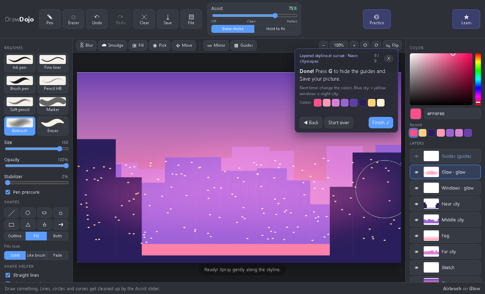

# Draw Dojo

**A free drawing app that helps you learn to draw.** Your wobbly lines get cleaned up as much
or as little as you like, step-by-step lessons show you where every line goes, and short drills
score your progress. Runs in the browser, nothing to install.

**[Try it online →](https://forkandcompile.github.io/draw-dojo/)**

## The idea: an Assist slider

When you lift the pen, Draw Dojo recognizes what you drew (a line, circle, oval, curve, triangle,
rectangle, star, zig-zag...), measures how close it is to the perfect shape, and moves your line
toward it by as much as the **Assist** slider says. At 0% your line stays as drawn, at 30% it's
less wobbly but still hand-drawn, at 100% it's perfect. A faint "ghost" of the perfect shape and a
score ("87% round") show you how you did, so you learn instead of just getting fixed.

## Features

- **Brushes**: ink pen, fine liner, brush pen, HB pencil and soft pencil (with paper grain), marker, airbrush, eraser, plus blur and smudge. Pen pressure supported.
- **Shapes**: stamp lines, circles, ovals, squares, rectangles, triangles, stars and arrows, as outline, fill or both.
- **Fill bucket** that sees all your lines, closes small gaps, fills behind lines, and can fill solid, with the look of your brush, or as a fade.
- **Hold still to pick a line**: hold the eraser on a line to delete it, hold a pen on a line to recolor it, or on an empty area to fill it.
- **Move tool**: move, resize and turn any line or group of lines.
- **Layers** with Normal / Glow / Shade blending, a light-blue guide layer for sketch lines, and mirror mode.
- **Zoom, pan, turn and flip** the page. Two-finger gestures on touch screens; palm rejection once you use a pen.
- **Reference photo** in a see-through side window or traced under your drawing.
- **23 lessons** that draw hints step by step, snap your lines into place and can set up the right brush, color and layer for you:
  - Faces (circle method, turned head, box method, the eye), bodies, hands, animals, landscapes, perspective, basic forms
  - Advanced: **neon cityscapes** (sunset skyline, rainy neon street, sci-fi megastructure), **anime** (face, eyes, chibi), **comics** (page layout, inking)
- **Practice drills** (circles, straight lines, ovals, curves, boxes) with a score for every try and your progress over time.
- **Any page format**: fit the screen, 16:9, 9:16 (phone / Shorts), square, 4:5, A4, comic page, or your own size.
- **Autosave** in the browser, project files that keep your layers, PNG export.

## Use it

**Online:** go to **https://forkandcompile.github.io/draw-dojo/** and press **Start drawing**.

**Offline:**

1. [Download the ZIP](https://github.com/ForkAndCompile/draw-dojo/archive/refs/heads/main.zip) (or clone this repository) and unzip it.
2. Double-click `index.html` and press **Start drawing** (or open `app.html` directly).

That's it. No install, no account, no internet needed after download. Chrome or Edge recommended.

> **Drawing tablet tip:** for pen pressure in the browser, open your tablet's driver settings
> (Wacom, Huion, XP-Pen...) and turn **Windows Ink** on.

## Keyboard shortcuts

| Key | Action |
|-----|--------|
| B / P / M / A / E | Pen / pencil / marker / airbrush / eraser |
| I / F / V | Eyedropper / fill / move |
| Ctrl+Z / Ctrl+Y | Undo / redo |
| Ctrl+S | Save as PNG |
| [ / ] | Smaller / bigger brush |
| + / - / 0 | Zoom in / out / fit |
| , / . | Turn the page |
| H | Flip the view |
| G | Show / hide guides |
| R | Mirror mode |
| Space + drag | Move the page |

## How it's built

Plain HTML, CSS and JavaScript with the canvas API. No frameworks, no build step: edit a file and
reload the page. A short tour of the code:

| File | What it does |
|------|--------------|
| `index.html` | the landing page |
| `app.html` | the app |
| `js/core.js` | document, layers, undo history |
| `js/brush.js`, `js/fill.js` | brushes, stabilizer, fill bucket |
| `js/shapes.js` | shape recognition, scoring and correction (the Assist) |
| `js/input.js`, `js/view.js` | pen input, zoom / pan / rotate |
| `js/items.js`, `js/move.js`, `js/stamp.js` | remembered strokes, Move tool, Shapes tool |
| `js/methods*.js`, `js/lesson.js` | lesson content and the lesson runner |
| `js/drills.js`, `js/reference.js`, `js/project.js` | practice, reference photo, saving |

See [PLAN.md](PLAN.md) for the design and the roadmap.

## Contributing

Ideas, bug reports and new lessons are very welcome. Open an issue or a pull request.

## License

[MIT](LICENSE): free to use, change and share.
